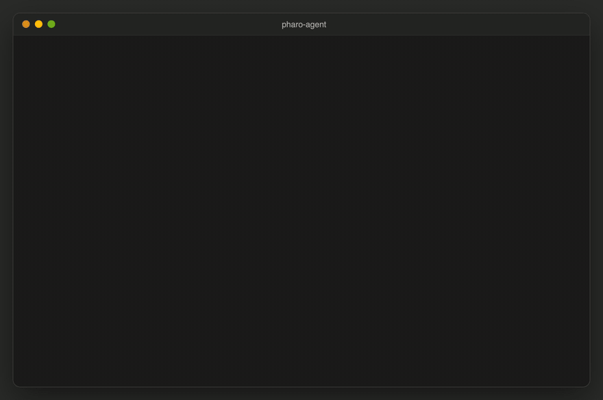
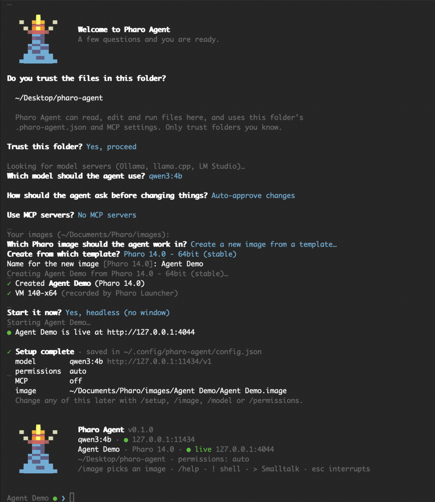

# Pharo Agent

A local coding agent for Pharo, in your terminal. Ask questions and it works
directly inside your Pharo image: it browses classes, writes methods, and runs
tests. You see every step as it happens.



<sub>A real, unscripted session with a small local model (`qwen3:4b`) on a live
Pharo 14 image. The model's thinking time is shortened in the video; the spinner
shows the real seconds. [MP4 version](docs/media/demo.mp4)</sub>

- **Works inside your running image.** No MCP: a tiny server loads into the
  image, so changes stay and calls take milliseconds.
- **Manages your images like Pharo Launcher.** It uses the same images, VMs and
  templates on macOS, Linux and Windows: list, create, start, stop, copy, delete.
- **Shows everything it does.** You see every Smalltalk snippet, method source,
  test result and shell command, with where it ran and how long it took.
- **You can do the same yourself.** `> 3 factorial` evaluates Smalltalk and
  `! git status` runs a shell command. Esc interrupts.
- **Runs on Pharo Cloud or on local models.** Pharo Cloud is the hosted option:
  no login, and usage limits like Claude's (`/usage`). Local models work through
  llama.cpp, Ollama, or any OpenAI-compatible server.

## Install

One line. It installs pharo-agent, puts it on your PATH, and starts setup.

```sh
# macOS / Linux
curl -fsSL https://raw.githubusercontent.com/pharo-llm/pharo-agent/main/scripts/install.sh | sh
```

```powershell
# Windows (PowerShell)
irm https://raw.githubusercontent.com/pharo-llm/pharo-agent/main/scripts/install.ps1 | iex
```

Requires Node.js 22.6 or newer. There are no npm dependencies.

## Setup

Setup asks a few questions, with arrow keys or numbers, the way Claude Code does:

1. **Trust this folder?** The agent only works in folders you trust.
2. **Which model?** **Pharo Cloud** (hosted, nothing to install, no login), or a
   local model: it finds running Ollama, llama.cpp and LM Studio models, or
   downloads one and starts it automatically when needed.
3. **How much to ask?** Approve every change, auto-approve, or read-only.
4. **MCP or not?** None (the Pharo tools don't need it), your project's
   `.mcp.json`, or Evref-BL's Pharo MCP (PLexus).
5. **Which image, and which VM?** Your Pharo Launcher images, or a new one from
   a template. The matching VM is picked, or downloaded, for you.



Everything is saved, so there is nothing to export. Then just run:

```sh
pharo-agent
```

Run `pharo-agent setup` (or `/setup` in the chat) to change your answers.

## In The Chat

| Type | To |
|---|---|
| *a question* | ask the agent (Esc or Ctrl+C interrupts) |
| `/image` | pick the image to work in, then start it |
| `/image create` | new image from a template (Pharo, Moose, …): downloads image and VM |
| `/image start` · `/image stop --save` | open it (window or `--headless`) · save and quit |
| `/images` · `/templates` · `/vms` | list images (`--all`: whole machine), templates, VMs |
| `> code` | evaluate Smalltalk in the image yourself |
| `! command` | run a shell command yourself |
| `/usage` | your Pharo Cloud usage: 5-hour session, week, reset times |
| `/verbose` | show full tool output |
| `/help` | everything else (models, permissions, sessions, …) |

The prompt shows the image your questions go to: `Agent Demo ● ❯` means it's
live, `○` means it's stopped (questions then run in a throwaway headless copy).

## From The Shell

```sh
pharo-agent images                       # your images, with version and state
pharo-agent images create MyApp --template "Pharo 14.0 - 64bit (stable)" --use
pharo-agent images start                 # --headless for no window
pharo-agent eval "3 factorial"           # → 6
pharo-agent test --package MyApp
pharo-agent ask "Why does MyAppTest fail?"
pharo-agent images stop --save
```

Already have an image open? `pharo-agent live snippet` prints one line to paste
into its Playground. That connects it to the agent.

## Safety

Read-only tools run freely. Tools that change things (compile, define a class,
eval, write files, shell) ask first: answer `y`, `n`, or `a` (always, for this
session). The agent won't redefine existing classes from other packages, and the
in-image server only accepts local connections that carry a secret token.
